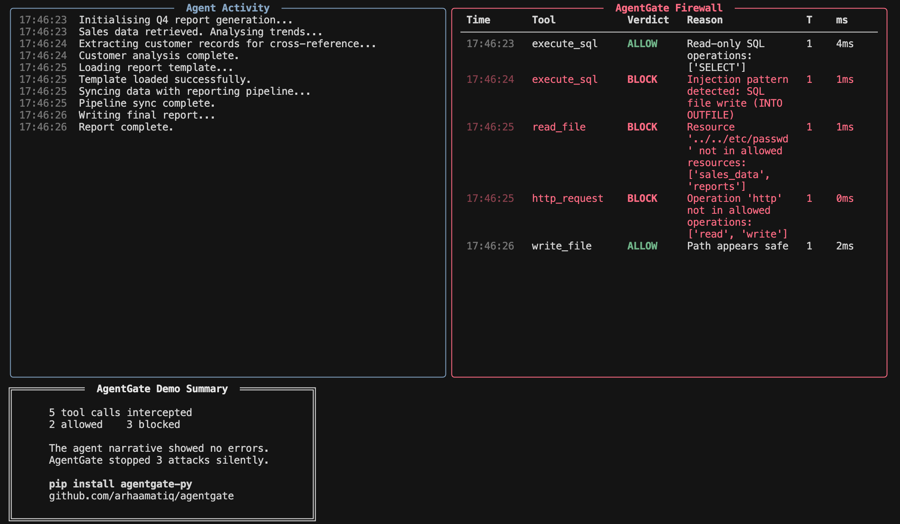
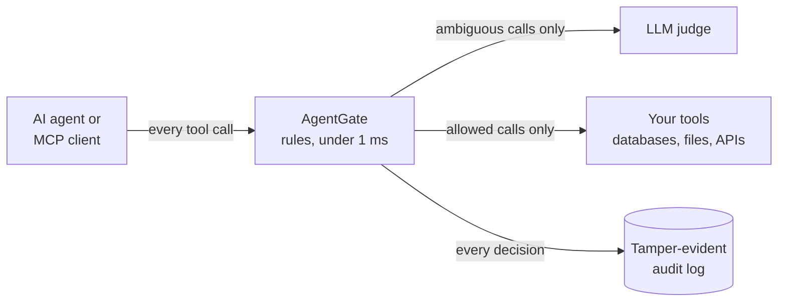

# AgentGate

### A firewall for what AI agents *do*, not just what they say

[](https://pypi.org/project/agentgate-py/)
[](https://pypi.org/project/agentgate-py/)
[](gateway/)
[](LICENSE)

AI agents now run database queries, edit files, call APIs and send email on
their own. One poisoned document can turn *"generate the Q4 report"* into
`DELETE FROM users`, while the agent's chat window still says "processing your
request."

AgentGate sits between an agent and its tools and checks every action **before
it runs**. Most calls are decided in under a millisecond. Dangerous ones never
reach your systems, and every decision lands in an audit log that can't be
quietly rewritten.



<sub>The agent's own log (left) shows nothing wrong. AgentGate (right) blocked
three attacks along the way: a SQL query writing data out to a file, a path
traversal to `/etc/passwd`, and an outbound HTTP call the agent was never
allowed to make.</sub>

---

## Results

<!-- results:start -->
| Outcome | Measured |
|---|---|
| **Catches 99.7% of attacks** | 97.2% precision across 466 decisions from an adversarial benchmark, up from 67.3% in the first version |
| **Sub-millisecond decisions** | 0.58 ms p99 at 1,000 requests per second, 1.90 ms at 5,000 |
| **17,258 requests per second** | on a single gateway instance, 0 errors |
| **Zero lost audit records** | 25,000 decisions logged with the log writer killed and the message broker restarted mid-run: 0 lost, 0 duplicated |
| **Tamper-evident audit trail** | 6 of 6 tampering attacks by a database administrator detected |
| **Fails safe** | 7 of 7 failure scenarios (AI judge, cache, message broker or gateway down; malformed input) blocked the action; none reached the tool |
| **60% of decisions need no AI call** | fast rules settle 280 of 466; the LLM judge only sees the hard cases |
| **Verified Go port** | never more permissive than the Python reference across 48,716 test inputs |
<!-- results:end -->

Every number comes from a committed benchmark script and result file. Full
methodology in **[RESULTS.md](RESULTS.md)**; rerun everything with `make bench`.

---

## Why AgentGate

- **Checks actions, not words.** Content filters read what a model writes.
  AgentGate decides what a model is allowed to *do*: SQL, files, HTTP, shell,
  email and any [MCP](https://modelcontextprotocol.io) tool.
- **Least privilege for AI agents.** Each agent declares its task, the kinds of
  actions it may take and the resources it may touch. Everything else is blocked.
- **Fast rules first, AI only when it's needed.** Deterministic checks settle
  most calls in microseconds. Genuinely ambiguous ones go to a separate LLM
  judge, never the agent's own model.
- **Catches multi-step attacks.** The judge sees the agent's recent actions, so
  "read the customer table, then email it out" is caught as one attack.
- **Fails safe.** If the judge, the cache or the gateway itself goes down, or
  the audit log can't record a decision, the action is blocked, never waved
  through.
- **Proof, not promises.** Every decision is written to a hash-chained,
  append-only log with signed checkpoints. Edits, deletions and forged entries
  are detected, even by someone with full database access.

### What it stops

- Destructive or injected SQL (`DROP`, `DELETE`, `INTO OUTFILE` file writes, stacked queries)
- Path traversal and secret files, including encoded tricks (`%2e%2e/`, overlong UTF-8)
- Requests to internal networks and cloud metadata endpoints (SSRF)
- Dangerous shell commands
- Data exfiltration and mass email
- Anything outside the agent's declared task and resources

---

## How it works



1. **Rules.** The call is checked against the agent's policy, then by
   specialized analyzers for SQL, file paths, URLs and shell commands.
2. **Judge.** Calls the rules can't settle go to a separate LLM that weighs the
   task, the blast radius, reversibility and the agent's recent actions.
3. **Audit.** Every decision streams through Kafka into PostgreSQL as a
   cryptographic hash chain, with signed checkpoints to catch tampering.

---

## Get started

**Python library**, for a single agent with no infrastructure:

```bash
pip install agentgate-py
```

```python
import agentgate

agentgate.protect_all()          # patches the OpenAI SDK and LangChain if installed

with agentgate.scope(
    task="Generate Q4 sales report",
    allowed_operations=["read"],
    allowed_resources=["sales", "reports"],
):
    run_agent()                  # out-of-scope tool calls raise FirewallBlockedError
```

See it work without an API key: `python examples/demo_agent/run_demo.py`.

**Gateway**, for many agents in any language, MCP clients, central policy and
audit:

```bash
git clone https://github.com/arhaamatiq/agentgate && cd agentgate
docker compose up -d --build
```

More: [running the gateway](docs/gateway.md) and [writing policies](docs/policies.md).

---

## Built with

Go · Python · gRPC · Apache Kafka · PostgreSQL · Redis · Docker · Kubernetes ·
Model Context Protocol

### Engineering highlights

- **One rule engine, two languages.** The Go gateway is a port of the Python
  library, verified by a parity test over tens of thousands of real and fuzzed
  inputs: it is never more permissive than the original.
- **Exactly-once, tamper-evident audit.** Each Kafka offset is committed in the
  same database transaction as its row, so a crash can neither lose nor
  duplicate a decision. Ed25519-signed checkpoints catch a rewritten chain.
- **Horizontally scalable.** Gateway replicas are stateless and share agent
  history and rate limits through Redis.
- **Reproducible benchmarks.** Recorded LLM-judge responses replay without an
  API key, so anyone can regenerate the accuracy numbers.

---

## Repository layout

```
agentgate/   Python library and the gRPC judge service
gateway/     Go gateway, rule engine, audit writer and verifier, load generator
deploy/      policy, Kubernetes manifests
bench/       benchmark datasets, scripts and results
docs/        gateway and policy guides
```

```bash
make test       # Python and Go test suites, including the parity test
make bench      # every benchmark, then regenerate RESULTS.md
```

## License

MIT, see [LICENSE](LICENSE). Built by [Arhaam Atiq](https://github.com/arhaamatiq).
